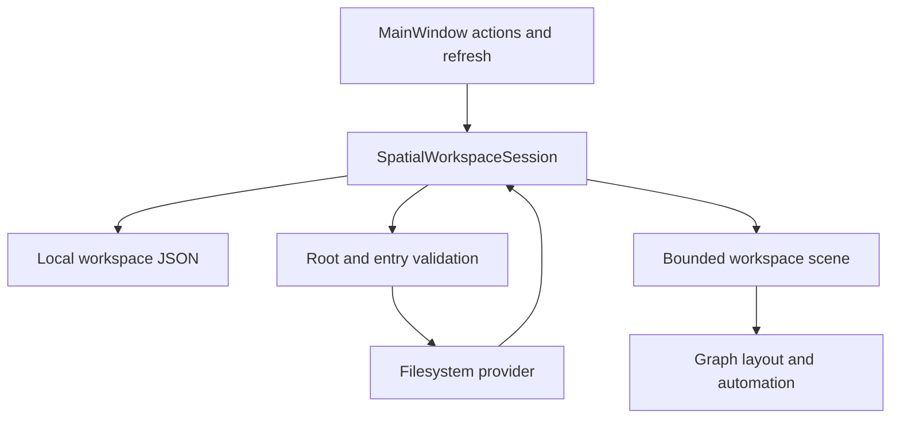

# Spatial workspace architecture

Current contract: **`1.2.0-nebula.5`**, one local-only `MainWindow`. The former My Files window, `ExplorerSession`, voice/audio, OmniSorSe transport, Context/Hybrid builders and diagnostics UI are removed. The shared previous-folder glyph kind remains for structural orientation; connected/view-mode/semantic relationship contracts are removed.

## Components

| Owner | Responsibility |
| --- | --- |
| [MainWindow](../src/OmniBrille.Desktop/MainWindow.axaml.cs) | Composition, picker actions, sidebar, keyboard, view reservation, filesystem watchers and refresh timers |
| [SpatialWorkspaceSession](../src/OmniBrille.Desktop/Presentation/SpatialWorkspaceSession.cs) | Saved-root authority, hierarchy navigation, bounded scene construction, search, transient result previews, selection and file activation |
| [SpatialWorkspace](../src/OmniBrille.Core/SpatialWorkspace.cs) | Normalized local roots, independent pins and authorized current location; maximum 8 roots and 12 pins |
| [JsonSpatialWorkspaceStore](../src/OmniBrille.Infrastructure/JsonSpatialWorkspaceStore.cs) | Bounded JSON persistence, atomic replacement and one-time legacy migration |
| [FileSystemExplorerProvider](../src/OmniBrille.Infrastructure/FileSystemExplorerProvider.cs) | Scoped local directory enumeration and name/path search |
| [FileMapPathGuard](../src/OmniBrille.Infrastructure/FileMapPathGuard.cs) | Path confinement and filesystem-entry validation before reads and file activation |
| [GraphSceneControl](../src/OmniBrille.Desktop/Rendering/GraphSceneControl.cs) and [WorkspaceGraphLayout](../src/OmniBrille.Core/WorkspaceGraphLayout.cs) | Deterministic root clusters, bounded glyph/label rendering, selection, graph input and automation |
| [ShellFileActivationService](../src/OmniBrille.Infrastructure/ShellFileActivationService.cs) | Revalidated explicit file opening through the operating system |

## State ownership

`SpatialWorkspaceSession` owns normalized roots/pins, current root/path, selected node, one displayed scene, search results and preview marker. `MainWindow` projects those values and owns only interface state: sidebar tab/collapse, settings visibility, hide-controls, timers and watcher lifetime. `GraphSceneControl` owns pan, zoom, hover animation and bounded drawing caches.

Each node has a root-qualified identity; identical paths under overlapping chosen roots cannot accidentally acquire another scope. Providers must match the exact requested local access root. Connected display paths or opaque IDs are never accepted as authority.

### Persistence and migration

`%LOCALAPPDATA%\OmniBrille\spatial-workspace.json` stores schema 1, up to 8 explicit roots with labels, up to 12 pins with names/order, and the current authorized root/path. Input is capped at 128 KiB with bounded depth and normalization. Saving uses a unique temporary file and replacement; a failed save leaves the live session usable with a visible unsaved status.

If this file is absent, the store reads explicit roots and pins from `file-map-workspace.json` and `pinned-folders.json`. Newer standalone pins take precedence when the combined list exceeds 12. Old files remain intact. A present empty, malformed or unsupported new workspace does not silently re-import legacy locations. No standard folder recommendations become implicit roots.

Saved unavailable roots and pins remain in the list. Launch restores the saved workspace and reads only its authorized location/overview. This differs from earlier previews that loaded pins without restoring a workspace. Search text/results, hovered paths, file contents, pan/zoom and sidebar state are not persisted. `visual-preferences.json` stores only theme, Reduced motion and Reduced effects; retired voice/sound/diagnostics fields are ignored and removed when loaded.

## Navigation and explicit pinned folders

The overview shows all chosen roots as separate clusters. Entering a folder displays its immediate children. Back, Up, graph right-click and `Alt+Left` all move to the containing folder; at the access-root boundary they return to the overview. There is no chronological Trail/history mode. Workspace / `Alt+Home` returns directly to the overview.

Choosing more roots adds to the existing set up to the limit. Removing a root updates authority and refreshes the scene/search without changing filesystem content. A pin inside chosen roots uses the deepest containing root. A pin outside every chosen root authorizes an excursion bounded to that exact pin, without adding or replacing monitored roots. Up from the pin boundary returns to the workspace. Removing the active excursion's only pin returns to the overview.

Pins are folder shortcuts, not search roots. Pin clicks revalidate availability. A missing location is retained and reported; it never broadens access or opens a file. Pin order is saved through drag, `Alt+Up` / `Alt+Down`, and context-menu actions.

## Search and transient previews

Search trims queries to 160 characters, reads only chosen roots and caps combined visible results at 80. Work is split across roots with a total directory budget of 500; partial/unavailable/truncated results are announced. Results from overlapping roots are deduplicated by native path. A pin outside the root set does not extend search scope.

Pointer hover or keyboard selection of a result validates its local path and marks the deepest existing visible ancestor in the same chosen-root authority, or the item itself when visible. No nodes or edges are added. An offscreen branch has no map marker; its full path remains in the sidebar. The committed current root/path stays unchanged. Leaving the result clears its marker. Density changes reproject the one scene and recompute any validated marker. The session counts matching descendants for visible nodes. Double-click or Enter on a folder result navigates there; on a file result it navigates to the containing folder and selects the file. File launch remains an explicit Open file / graph activation action.

Cancellation and navigation, search, preview and workspace generations reject late work. A preview cannot overwrite a newer navigation/root set, and a pending directory load commits only its location—not stale roots or pin order captured before awaiting. Refresh reruns an active query and restores a valid preview only when its originating generations still match.

## Scene and rendering bounds

The workspace scene has at most 64 nodes. Overview acquisition admits each root, up to six immediate children; responsive presentation reduces visible children for narrow or many-root layouts. A focused folder projects its cached bounded directory snapshot into pages of 4–60 children, with previous/next controls inside the same bound. The shell normally shows 24 children, reducing to 4–8 on short/compact canvases and reducing further for larger text. Resizing reprojects the cached snapshot without new filesystem work. Enumeration is capped at 5,000 entries; truncation is visible. The parent folder glyph opens its contents directly; the synthetic Open folder node is removed. Search markers never expand the scene.

The renderer uses compact outlined folder/document glyphs, real containment edges, deterministic cluster placement and bounded caches. Thin straight connections have constant color and width across hover/selection and are clipped around all glyph and label bounds. Local hover uses a soft glow and label background; the former moving/enlarging lens, floating positions, preview route glow and dust are removed. Reduced motion stops the local pulse. No animation ticker runs when the scene is idle. Shared static glyph geometry avoids rebuilding the same paths. Text, hit targets, label obstacles and connector endpoints use the same scene geometry. Nebula/Light and Reduced motion/effects share the same navigation state. Automation is a bounded projection of visible graph nodes, not an independent filesystem browser.

## Refresh and lifecycle

While the window is open, recursive `FileSystemWatcher` instances monitor only chosen roots. Events coalesce into an 850 ms refresh interval without restarting the timer for every event; a 20-second timer reconciles watchers and requests a bounded refresh to recover missed events and returning drives. Refresh defers while navigation/search is busy. `Ctrl+R` requests refresh explicitly. This is live view maintenance, not a persistent index, whole-machine scan or background service. Pins outside chosen roots do not add watchers.

Window close disposes watchers/timers and cancels session work. Hidden controls do not stop refresh or change roots/query/location. The shell recalculates reserved graph space when hidden/collapsed; hiding leaves a search field and restore button. Submitting minimal search or pressing `Ctrl+F` shows Search results while keeping normal window controls hidden. No hide/collapse setting is persisted.

## Authority and evidence limits

Path checks reject escaping paths and link/junction redirection. Recognized native cloud placeholders have a separately classified path policy; see [security and privacy](SECURITY-PRIVACY.md). Being listed locally does not guarantee remote availability. Native OneDrive hydration, installed Windows UX, screen readers, DPI and GPU behavior require explicit platform evidence.

[ADR 0006](decisions/0006-local-spatial-workspace.md) records this boundary. [Testing](testing.md) and [packaging](PACKAGING.md) define verification; earlier reports do not prove this version passed.
